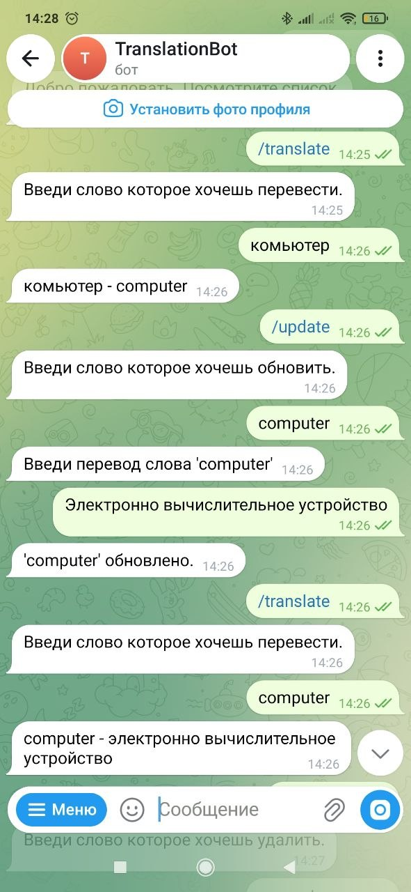
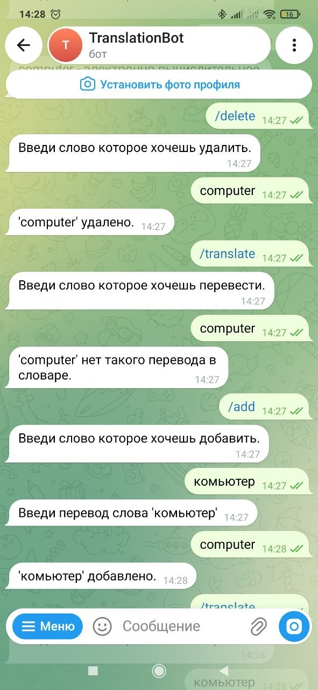
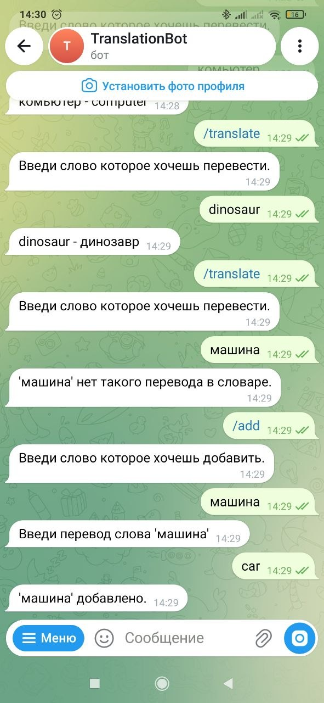

# 🌍 TranslationBot

Telegram-бот для перевода слов между русским и английским языками. Поддерживает добавление, обновление и удаление слов — словарь хранится в базе данных и не теряется при перезапуске.



## 🛠 Стек технологий

- Python 3.11+
- aiogram 3 — фреймворк для Telegram-ботов
- aiosqlite — асинхронная работа с SQLite
- python-dotenv — управление секретами через .env

## ✨ Возможности

- 🔤 Перевод слов в обе стороны (RU ↔ EN)
- ➕ Добавление новых слов в словарь
- ✏️ Обновление существующих переводов
- 🗑 Удаление слов из словаря
- 🧠 Автоопределение языка — русское слово или английское
- 🧹 Нормализация ввода — регистр, знаки препинания
- 📋 Встроенное меню команд (BotCommand) — не нужно печатать команды вручную
- 💾 База данных SQLite — слова сохраняются между перезапусками

### 🧠 Автоопределение языка

Бот сам понимает, на каком языке слово:

- компьютер → определит как русское → переведёт на английский
- computer → определит как английское → переведёт на русский

Не нужно указывать направление вручную.

## 🚀 Установка и запуск

### 1. Клонировать репозиторий
```bash
git clone https://github.com/USERNAME/translation-bot.git
cd translation-bot
```

### 2. Создать виртуальное окружение

```bash
python -m venv venv

# Linux / Mac
source venv/bin/activate

# Windows
venv\Scripts\activate
```

### 3. Установить зависимости

```bash
pip install -r requirements.txt
```

### 4. Получить токен бота

- Открой Telegram → **@BotFather**
- Отправь `/newbot` → следуй инструкциям
- Скопируй полученный токен

### 5. Настроить `.env`

Скопируй `.env.example` в `.env`:

```bash
cp .env.example .env
```

Содержимое `.env`:

```
BOT_TOKEN=ваш_токен_здесь
DB_PATH=translation.db
```

### 6. Создать и наполнить базу данных

```bash
python init_db.py
python seed.py
```

### 7. Запустить бота

```bash
python main.py
```

## 📸 Скриншоты

| Перевод и обновление | Добавление и удаление | Меню команд |
|---|---|---|
|  |  |  |

## 🎮 Как пользоваться

| Команда | Что делает |
|---|---|
| `/translate` | Перевести слово (автоопределение языка) |
| `/add` | Добавить новое слово в словарь |
| `/update` | Обновить перевод существующего слова |
| `/delete` | Удалить слово из словаря |
| `/help` | Список команд |

## 📁 Структура проекта

```
translation-bot/
├── screenshots/            # скриншоты для README
│   ├── 01_main.png
│   ├── 02_delete_add.png
│   └── 03_menu.png
├── .env.example
├── .gitignore
├── commands.py             # CRUD-операции над словарём
├── config.py               # конфигурация
├── init_db.py              # создание таблиц
├── main.py                 # точка входа, хендлеры
├── requirements.txt
├── seed.py                 # наполнение БД
├── words_data.py           # начальный словарь для seed
└── README.md
```

## 📄 Лицензия

MIT